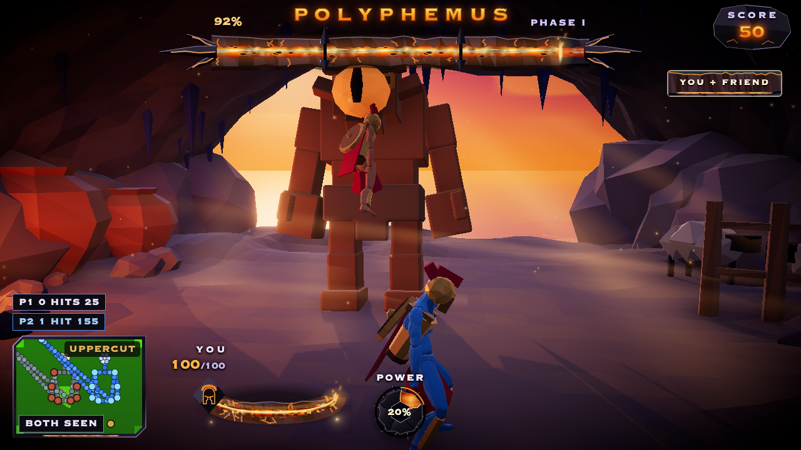
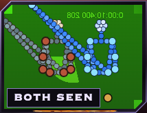

# Two players on one camera

Two people stand side by side in front of one computer. The game follows both bodies, each gets a hero of their own, and they fight one monster together. Issue #28.

The code is in `src/duo/`. It is **mounted**: the Multiplayer screen has the card "Two players, one camera", and five files outside `src/duo/` turn it on (see "Where it is mounted").

## How it works

1. **The camera finds two bodies.** With the choice on, the pose model is asked for two bodies in each picture (`numPoses: 2`). With it off the model is asked for one, exactly as today.
2. **Seats** (`src/duo/assign.ts`). Every body found goes to `createSeating()`. Which body is which is decided by `assignPlayers` from `src/pose/players.ts` (PR #99): of a fresh pair, the one on the left of the picture is player one; after that each body goes to the player it moved least from, so walking past each other or the model swapping its order does not swap the players. On top of that:
   - a body with hidden shoulders, a body with shoulders under 6% of the picture (someone in the background), and one person the model found twice are dropped;
   - the second player **joins** after standing in the picture for 1 second without a break, and only with shoulders at least 0.6 of player one's (`BEHIND`). Someone smaller than that stands well behind player one, more than one and a half times as far from the camera: a spectator. They are not let in, because a defend counts only when both make it and they would cost the player every one. The widths compared are each seat's widest of the last second or so, so shoulders that go narrow in a punch change nothing. It is asked only at the join: a player who is in stays in;
   - the second player has **left** after not being seen for 0.7 seconds in pictures that keep coming; fewer lost frames change nothing. A hitch in the pictures themselves (none at all for up to 1.5 seconds) is not a leave;
   - if **player one** walks out and the other stays, after 0.4 seconds the one who stayed becomes player one. Their picture is moved and sized to where the first hero stood, so the stance measured at calibration still fits and the fight does not stop to ask anyone to step back in. "Where each stood" is the middle value of their place over the last 3 seconds (`HOME_MS`), so a walk out of the picture or a dodge does not move it.
3. **Each body is read on its own** (`src/duo/split.ts`). Player two gets their own history, their own neutral stance (taken from their first 8 frames, and again at the moment they join) and their own `createPoseInput`, the same reader a single player gets. Standing to one side does not matter: every detector measures against the body's own stance.
4. **The link** (`src/duo/duoLink.ts`). The fight screen already takes a `HostLink` for online rooms, and the FaceTime call uses the same one. `createDuoLink` builds that same link on a transport that never leaves the page, and feeds player two's strikes in as the guest's. So the fight, the "Together! x2" flash and the scoring are the room fight's, unchanged.
5. **The second hero** (`src/duo/SecondFigure.tsx`): the same spartan in blue, to the hero's right, moved by player two's body. Drawn only while two are playing.
6. **The choice** (`src/duo/ui/DuoCard.tsx`): a card on the Multiplayer screen, "Two players, one camera".
7. **Both are shown and both are counted** (`src/duo/tally.ts`, `src/duo/ui/duoOverlay.ts`): see the next section.

## What the two players see



- **Two skeletons in the camera panel**, on the standing-still screen and in the fight. Player one's is the panel's own (grey stones, red joints). Player two's is blue, like their hero, and is drawn as soon as the camera has their body, also before they have joined. A body that is gone leaves no skeleton behind (0.3 seconds). 
- **Two plates above the camera panel in the fight**: `P1 3 hits 420` and, in blue, `P2 2 hits 310`. Before player two has scored, their plate says what the camera makes of them: `P2 not seen: step apart` (no second body in the picture; the usual reason is standing too close, see "How to stand"), `P2 joining` (a body is there and has not yet stood for a second, or stands too far behind), then their numbers. Once they have scored the numbers stay, with `, not seen` added while they are out.
- **On the end panel** the score line carries the same numbers: `Score 2140 · P1 6 hits 1780 · P2 2 hits 360`.

How it is counted. The fight keeps one score, and the tally splits it without changing a rule, so the two numbers always add up to the score:

- a landed strike is a hit for whoever threw it, and they get its points; thrown by both ("Together!"), it is a hit for each and each gets half;
- the 50 points of a defend are shared when both had to make it; with player two out they are player one's;
- the god's power is player one's.

The fight's own events do not say who threw a strike (`enemyHit` has no player), so the link counts: it knows which player's strikes it handed to the fight on that frame. P1 and P2 are the seats, not the people: after a take-over the one who stayed is P1 and scores as P1 from then on.

The plates are not by the "You + Friend" tag because the prompt card covers that corner for most of the fight. They and the blue skeleton are laid over the page by `src/duo/ui/duoOverlay.ts`, which finds the camera panel and the end panel by their class names (`.camera-frame`, `.fight > .camera-view`, `.fight > .overlay > h1 + p`) and changes no file under `src/hud/` or `src/screens/`. It runs only from "Play side by side" until duo is turned off. A room fight and a FaceTime fight are also two-player fights, and show none of this: there the second player is not in this camera's picture, and the fight's events alone cannot say who struck.

"Left" means left in the mirrored picture the game shows, which is also the left of the room as the players see it. The person on the left is player one.

## The rules of a duo fight

- Both strike. The prompt asks both for the same strike.
- **Together:** if both land the prompted strike within 0.4 seconds of each other, it does double damage. This is the room rule (`TOGETHER_MS` in `src/net/host.ts`): the first strike is held up to 0.4 seconds for the other.
- **Each defends for themself:** the defend the attack asks for counts only when both players have made it. If either misses it, the attack lands. The two share one health bar (the engine has one). `createDuoLink(..., { defend: "first" })` gives the room rule instead, where only player one defends.
- **One leaves:** if player two leaves, the fight goes on with one player with no pause: strikes land at once and player one defends alone. If player one leaves, player two takes over as said above. When the other comes back and stands for a second, they are in again.

## How to stand

- Side by side with **a full arm's length of empty space between you**. This is the one that matters: measured with drawn figures on this model, two bodies whose middles are closer than about half a body height (about 0.85 m for adults) come back as ONE body, and the game then plays as one player. Standing the way people naturally stand next to each other is too close. When the plate reads `P2 not seen: step apart`, step apart.
- Legs are not needed, except for kicks. Do not stand so close to the camera that you are cut at the waist: the bigger the bodies are in the picture, the more room the model needs between them.
- About 2 to 2.5 metres from a laptop camera. Player one must be inside the middle half of the picture (the game's presence check); the shoulders of each should be wider than a tenth of the picture.
- Level with each other. A second player well behind the first (shoulders under 0.6 of theirs) is taken for someone watching and is not let in until they step forward.
- Do not stand one behind the other. When two bodies overlap fully for more than a moment the model sees one person, and the two can come out swapped.
- Player two: walk in, stand still with arms down for a second. That is when the game takes your neutral stance.

## Where it is mounted

Five files outside `src/duo/` (the skeleton and the plates of "What the two players see" need none: they are laid over the page from `src/duo/`). The card uses the Multiplayer screen's own card classes, so it takes the look of the other cards.

- `src/pose/tracker.ts`: ask the model for `duoCamera.wanted()` bodies (it changes on the running model with `setOptions`), and while duo is on hand every body to `duoCamera.take`, which gives back player one's frame.
- `src/screens/Multiplayer.tsx`: `<DuoCard onStart={(link) => { props.onOpen(); props.onStart(link); }} />` in the row of cards.
- `src/render/Scene.tsx`: `<SecondFigure />` next to `<Hero>`.
- `src/App.tsx`: one effect that turns duo off when the player leaves that way of playing. And when the camera does not start after "Play side by side", the player lands on the main menu, where the camera problem card is: not back on the Multiplayer screen with nothing said, and not in a keyboard fight as a room's host does (two players on one camera have no room to keep and cannot play without the camera).
- `src/hud/CameraView.tsx`: the skeleton is drawn from `duoCamera.seen(frame)`. After player two takes over as the hero, the fight's frame is moved to where the first hero stood; this draws the skeleton on the player in the picture instead. Without this line the game plays the same, and only the skeleton is in the wrong place after a take-over. While duo is on, the panel's tag reads "One seen" or "Both seen" instead of "Your body", so the players can tell whether the second one is in.

With the choice off nothing changes: the model is built with one body, the old code path returns the frame, and `duoCamera.seen` gives back the frame it was given.

## The smoke script

```
node scripts/duo-smoke.mjs
node scripts/duo-smoke.mjs --shots=shots/duo
```

It starts the dev server on a free port, opens the game in headless Chrome and prints one PASS or FAIL line per check; the exit code is 1 when a check fails. `--shots=<folder>` saves ten pictures (the Multiplayer screen at both sizes, the standing-still screen, the camera panel close up, and the fight with two heroes, after player two's own hit, at the doubled hit, after player two left, after the take-over and at its end). It needs Chrome and Playwright, found the same way as in `scripts/smoke.mjs` (`FPS_PLAYWRIGHT`, `FPS_CHANNEL`, `FPS_GL`). One run takes about a minute and a half: it plays the fight to its end.

When the Multiplayer screen has no two-player card, it prints `SKIP: the Multiplayer screen has no two-player card yet` and exits 0.

With the card mounted, it plays a fight with the pose path on. Chrome's fake camera runs the real tracker; the bodies the tracker hands to `duoCamera.take` are swapped for two made-up ones, built from the same frames the unit tests use. Player one calibrates and fights from a made-up body too, so the "step back" pause is live and a pause would be seen. It checks:

- the card is on the Multiplayer screen, and fits at 1280x720 and 1600x900 (inside the window once scrolled to, nothing spilling out, not over another card);
- pressing it starts a fight, with two bodies asked for;
- on the standing-still screen before the fight the second body already has a blue skeleton in the camera panel;
- the second body gets a figure of its own;
- in the fight the camera panel draws both skeletons: the second is blue and stands to the right of the first, which has no blue in it;
- the second body alone lands the prompted strike, with no "Together" flash;
- the plates then read one hit for the second body and none for the first;
- both bodies striking 200 ms apart give the doubled hit, with the flash, and it is a hit for each on the plates;
- a defend made by only the first body, and one made by only the second, both cost health; one made by both costs nothing;
- the second body leaves: one hero, the fight never stands still, the first body's next strike lands;
- its skeleton is gone from the camera panel, and its plate keeps its hits and says "not seen";
- the camera panel's tag reads "Both seen" with two bodies and "One seen" after the second left;
- the second body comes back, then the first leaves: the one who stayed is the hero, drawn where the first hero stood, the fight never stands still, and their next strike lands;
- the camera panel's skeleton is on the promoted player (skipped with a line when `CameraView.tsx` was left out of the mount);
- the one who stayed fights on to the end: the end panel's score line carries each player's hits and points, and the points add up to the score (a NOTE and no failure when the fight does not end inside `--cap` seconds);
- no console error. Requests to `/api` are left out of this: the dev server has no game server behind it.

"Never stands still" is measured: the longest time the fight's state did not change must stay under half a second (the pause for a lost body lasts at least a second). On a busy machine the tracker itself can stop handing over pictures for a while; the fight then pauses whoever is in the picture, the check fails, and the line says so. Run it again.

## What was tested

- `npx vitest run tests/duoAssign.test.ts tests/duoLink.test.ts tests/duoTally.test.ts`: 44 tests with made-up landmark frames (the tally, the take-over's place and the second skeleton's frame were added with "What the two players see"). Seats through a crossing and through lost frames; joining and leaving; someone well behind the player who is never let in, also while the player's shoulders are narrow in a punch; player one leaving; where the promoted player is drawn in the camera panel; bodies that are dropped; two bodies giving two inputs; player two's strike reaching the real engine through the link; both striking for double damage; each defending for themself; the fight carrying on at once when player two leaves.
- `node scripts/duo-smoke.mjs` with the diff applied: the last two full runs passed every check (one with all five files, one without `CameraView.tsx`). Two earlier runs, made while the script was being written, went wrong in ways that are not the two-player code as far as could be told: in one the fight stood still for 23 seconds after the first body left, on a laptop that was running other browsers at the time (that run is why the script now measures the gap between the tracker's pictures; it did not happen again in four more runs); in one the dev server reloaded the page and the card could not be pressed (the script now loads everything once before it starts). A single-body strike took 14 to 18 health and a doubled one 30 to 40.

## What was not tested

- **No real camera with two real people.** Everything above uses made-up frames. How well MediaPipe's lite model holds two real bodies side by side, at what distance, and in what light is not known. The made-up bodies never overlap, never turn sideways, and are always fully in the picture.
- **The cost of two bodies was not measured.** In the smoke run the model is asked for two bodies but the fake camera shows nobody, so its time says nothing about two real people. Expect the body model to run once per person, so roughly twice the time of one player; measure with `?debug` (`window.__trackerStats.detectMs`) on the demo laptop, with two people, before showing it.
- Calibration with two real people in the picture. In the smoke run the made-up player one stands at 0.38 of the picture and player two at 0.70.
- A take-over while both players keep moving across the picture. Each one's place is the middle of their last 3 seconds, which is right for people who stand to fight and off for people who are walking.
- Edge, and software GL. The runs were in Chrome on the laptop's own GPU.

## Two faults the smoke script found

The check "a defend counts only when both make it" failed about one run in three on a busy laptop. Both causes were in `src/duo`, not in the script, and both have unit tests now.

- **Player two's stance was taken at a chance moment.** The shared pose history takes a stance once 20 frames fit inside one second. Player one never relies on that (calibration gives theirs), but player two did. At about 20 pictures a second that moment came late and at random, sometimes in the middle of a dodge. Standing still then read as the opposite dodge for the rest of the fight: a dodge made by player one alone counted for both, and a dodge made by both in the other direction did not count. Under 20 pictures a second player two would have had no stance at all, so no dodge or duck of theirs would ever have been read. Now the stance comes from player two's first 8 frames (`STANCE_FRAMES` in `src/duo/split.ts`).
- **A hitch in the pictures counted as player two leaving.** With no picture for 0.7 seconds the count fell to one player and came straight back. For that moment player one defended for both, and player two's stance was taken again from whatever they were doing. Now only pictures that keep coming without player two count them out; pictures stopping altogether does so after 1.5 seconds (`STOPPED_MS` in `src/duo/assign.ts`).

After the two fixes the script passed six runs out of six with the diff applied.

## What a try with two real people showed

A teammate tried it with a second person and saw only one player. There is no recording of that try. What was found afterwards, with drawn figures on Chrome's fake camera and never with real people:

- The model does hand over two bodies after the game switches it from one to two on the running model (two bodies on every frame after the switch, at the cost of one slow frame). The game seats, joins and scores a second body it is given.
- The model gives ONE body when the two stand close (see "How to stand"). That is the likely cause, and the screen said nothing about it: "You + Friend" was up either way, the camera panel drew one skeleton, and there was one score. The second skeleton, the plates and the new wording on the card are the answer to that.
- One real fault was in the take-over. The place a player was moved to and from was the average of each seat's first 15 frames. For real people that is the moment one of them is at the computer pressing the button, close and large, and the other is walking in. In the made-up case of the test, a take-over then drew the hero left of the picture's middle half and two and a half times too big: that is what pauses a fight on "move into view" with both people in view. It is now the middle of the last 3 seconds; `tests/duoAssign.test.ts` has the case.

## Known rough edges

- **Duo stays on until "Main menu".** Every fight picked from the map after a duo fight is still a duo fight: the model looks for two bodies (about twice the time per picture) and anyone who stands level with the player for a second is player two, whose defends are then needed. Before someone plays alone, go to the main menu; that turns duo off.
- **People watching.** Someone well behind the players is not let in (see Seats), but someone standing level with them is a player as far as the game can tell. The model is asked for two bodies, so with three people in the picture it may follow one who is watching and not the second player. And of two bodies seen in the very first picture, the left one is player one whatever their size, so someone watching on the left at that moment is the hero: go to the main menu and start again. Keep people who watch out of the picture.
- **The tally follows the seat, not the person.** When the two come out swapped after standing too close, or after a take-over, each goes on scoring on the other's plate.
- **A hit by player two is shown by player one's hero.** The fight has one hero that leaps at the monster, whoever struck. Player two's own figure follows their body but plays no strike.
- Nothing on the screen says which of the two missed a defend.
- Player two's skeleton stays drawn while the fight is paused; player one's is hidden then.
- The plates and the blue skeleton find their places by class names of the camera panel and the end panel. If those are renamed, they are simply not drawn; the smoke script's checks then fail.
- A model rebuilt after a graphics fault (`src/pose/tracker.ts`) while duo is being switched may keep the old number of bodies. Seen in the code, not reproduced, and not changed here.
- The "You + Friend" tag stays up for the rest of a fight after player two leaves, and after a take-over. It is drawn by the HUD (`src/hud/TogetherFlash.tsx`) from the fight's own state, which was started for two; nothing in `src/duo` can change it. The link knows the truth: `link.guestHere()` is false once player two has left. The smoke script prints a NOTE line while this is so. The camera panel's own tag ("One seen", "Both seen") does follow who is there.
- With the FaceTime card shown there are four cards in the Multiplayer row. They fit in one row with no scrolling from 1280x720 up; the row is then wider and its buttons are set in smaller type (`.mp-cards:has(.ft-card)` in `src/ui/set/screens-mp.css`).
